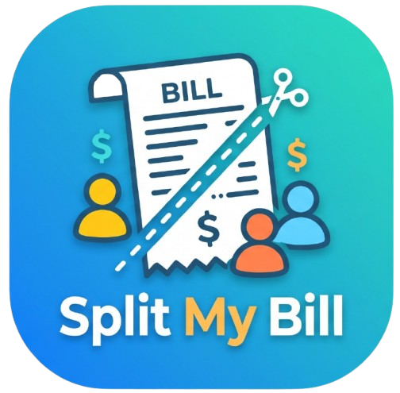

<p align="center">
  
</p>

<h1 align="center">Split My Bill</h1>

<p align="center">
  A clean, simple, and intuitive <b>Flutter</b> application to quickly calculate and split bills, taxes, and tips among friends.
</p>

<p align="center">
  
  
  
</p>

---

## ✨ Features

- **Real-Time Summary Card** — Instantly preview the total bill, number of people, tax percentage, and tip percentage.
- **Interactive Person Slider** — Easily adjust the split between **1 to 10 people**.
- **Quick Tip Selector** — Choose a tip percentage to add to the bill.
- **Tax Percentage Input** — Factor in local tax rates seamlessly.
- **Built-in Custom Numpad** — Enter the bill amount quickly without relying on the system keyboard.
- **Detailed Result Breakdown** — View the final total per person along with individual breakdown cards on the result screen.

---

## 🛠️ Tech Stack

- **Framework:** [Flutter](https://flutter.dev/) (Material 3)
- **Language:** [Dart](https://dart.dev/)
- **Typography:** [`google_fonts`](https://pub.dev/packages/google_fonts) (Poppins)
- **Icons:** [`flutter_launcher_icons`](https://pub.dev/packages/flutter_launcher_icons)

---

## 📂 Project Structure

```text
lib/
├── main.dart                  # Application entry point & route configuration
├── pages/
│   ├── home_page.dart         # Main bill input & calculation screen
│   └── result_page.dart       # Final per-person split breakdown screen
├── style/
│   └── theme.dart             # App colors & Poppins typography styles
└── widgets/
    ├── numpad_screen.dart     # Custom on-screen numeric keypad
    ├── person_slider.dart     # Slider for selecting number of people
    ├── result_person_card.dart# Per-person share breakdown list/cards
    ├── split_bill_button.dart # Primary action button to calculate split
    ├── summary_card.dart      # Overview card on Home page
    ├── summary_result_card.dart # Overview card on Result page
    ├── tax_input.dart         # Tax percentage input field
    └── tip_selector.dart      # Tip percentage selector
```

---

## 🧮 Calculation Formula

$$\text{Tax Amount} = \text{Total Bill} \times \left(\frac{\text{Tax \%}}{100}\right)$$

$$\text{Tip Amount} = \text{Total Bill} \times \left(\frac{\text{Tip \%}}{100}\right)$$

$$\text{Grand Total} = \text{Total Bill} + \text{Tax Amount} + \text{Tip Amount}$$

$$\text{Bill Per Person} = \frac{\text{Grand Total}}{\text{Number of People}}$$

---

## 🚀 Getting Started

### Prerequisites

- [Flutter SDK](https://docs.flutter.dev/get-started/install) (`^3.13.5`)
- An IDE (VS Code or Android Studio)
- An Android/iOS emulator or physical device

### Installation

1. **Clone the repository**
   ```bash
   git clone https://github.com/your-username/split_my_bill.git
   cd split_my_bill
   ```

2. **Install dependencies**
   ```bash
   flutter pub get
   ```

3. **Run the app**
   ```bash
   flutter run
   ```

### Building a Release APK

To build a release APK for Android:
```bash
flutter build apk --release
```

To build smaller per-architecture APKs:
```bash
flutter build apk --split-per-abi
```

The generated APK will be located at:
```text
build/app/outputs/flutter-apk/app-release.apk
```

---

## 📄 License

This project is open source and available for learning and personal use.

